# QuizMUJ

A proctored quiz and assessment platform for **Manipal University Jaipur**. Students take timed exams in a distraction-free focus mode and get instant, topic-level feedback. Faculty create and schedule quizzes for exact cohorts, watch exams live, and analyse results.

**Stack:** vanilla HTML/CSS/JS frontend · Node.js + Express 5 · MongoDB (Mongoose 9) · Socket.io · Nodemailer

<p align="center">
  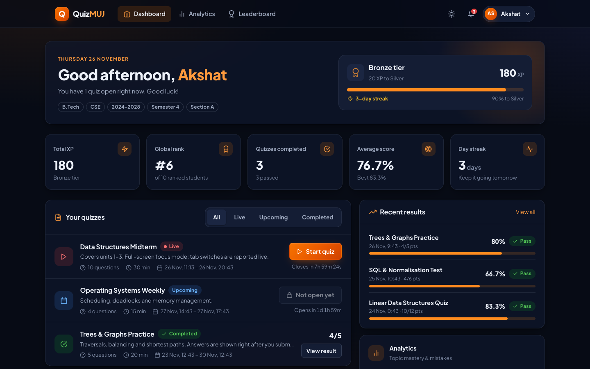
</p>

---

## Screenshots

### Students

<table>
  <tr>
    <td width="50%">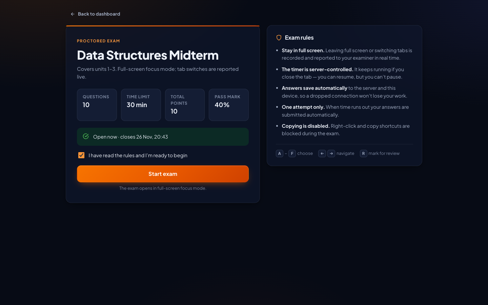<br><b>Exam lobby</b>: the rules, quiz facts and a ready check before the exam opens in full screen.</td>
    <td width="50%">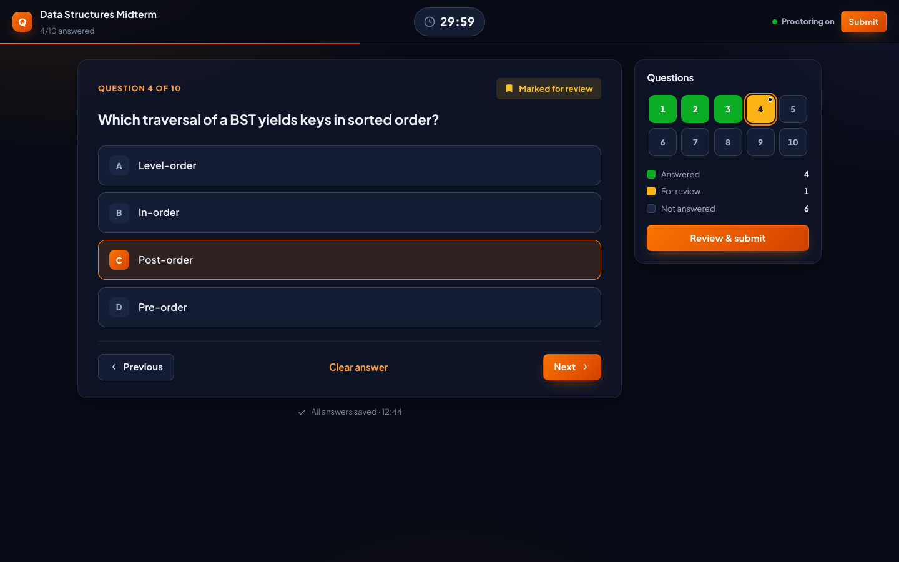<br><b>Focus-mode exam</b>: server-controlled timer, question palette, mark-for-review and autosave.</td>
  </tr>
  <tr>
    <td width="50%">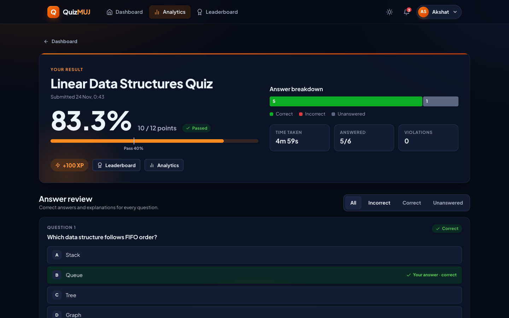<br><b>Result and review</b>: score against the pass mark, XP earned, and every question with its explanation.</td>
    <td width="50%">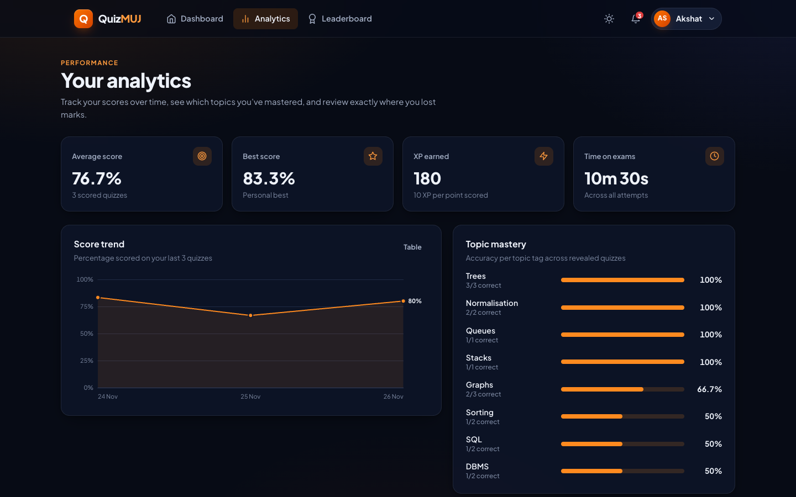<br><b>Analytics</b>: score trend and topic mastery built from question tags.</td>
  </tr>
  <tr>
    <td width="50%">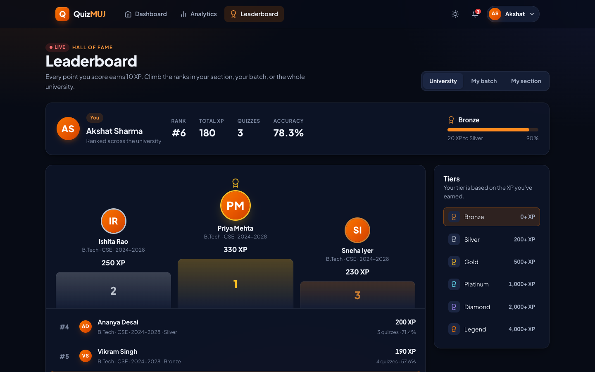<br><b>Leaderboard</b>: university, batch and section rankings with a podium and tiers.</td>
    <td width="50%">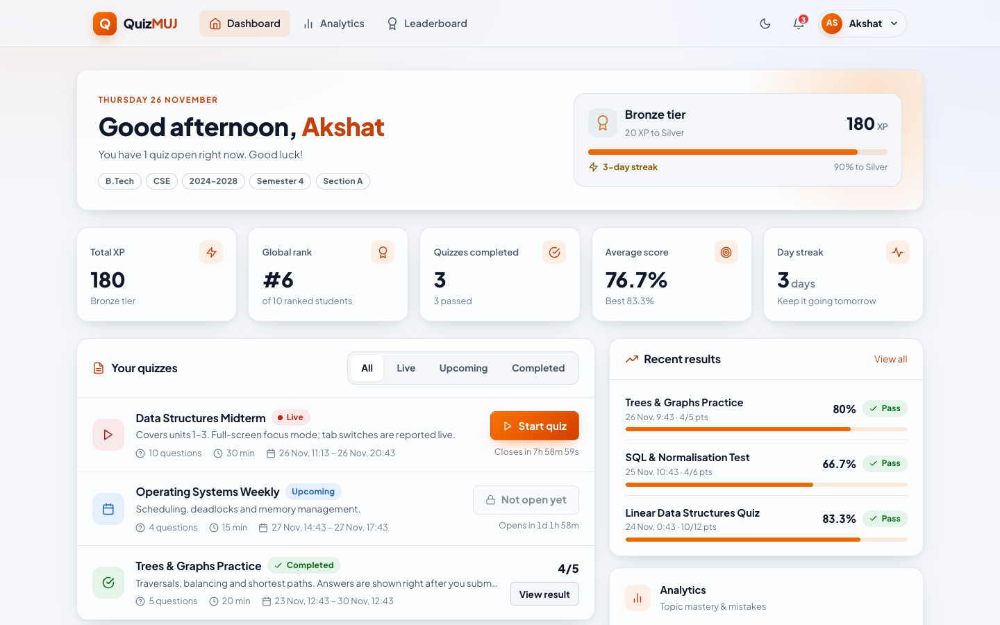<br><b>Light theme</b>: every page comes in dark and light.</td>
  </tr>
</table>

### Faculty

<p align="center">
  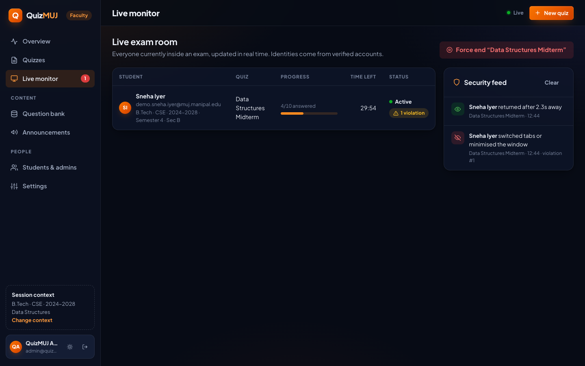
  <br><b>Live monitor</b>: every student in an exam with progress, time left and presence. Tab switches appear in the security feed as they happen.
</p>

<table>
  <tr>
    <td width="50%">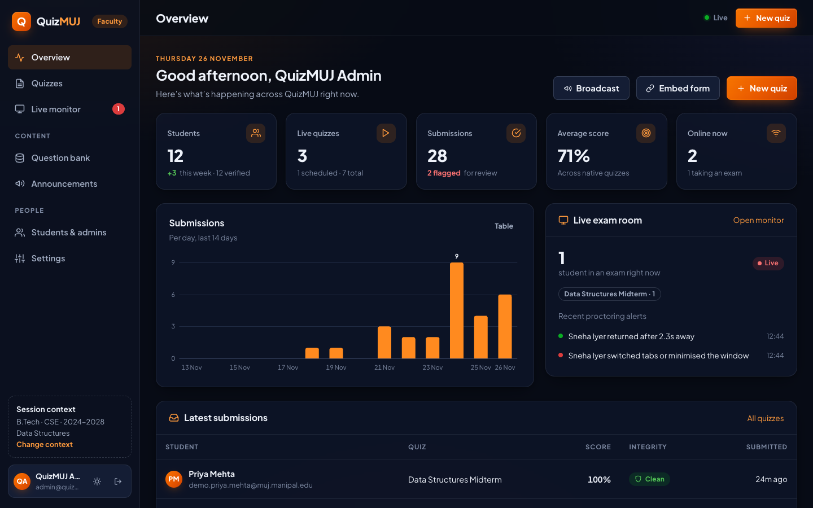<br><b>Overview</b>: students, live quizzes, submissions, a 14-day activity chart and the live exam room.</td>
    <td width="50%">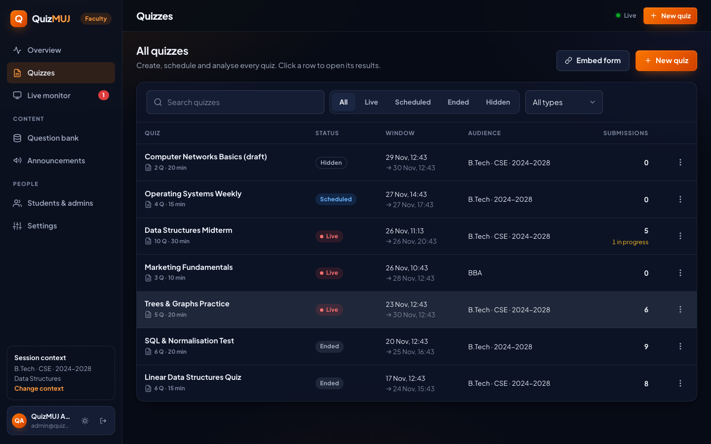<br><b>Quizzes</b>: search and filter every quiz by status, and open any quiz's results in one click.</td>
  </tr>
  <tr>
    <td width="50%">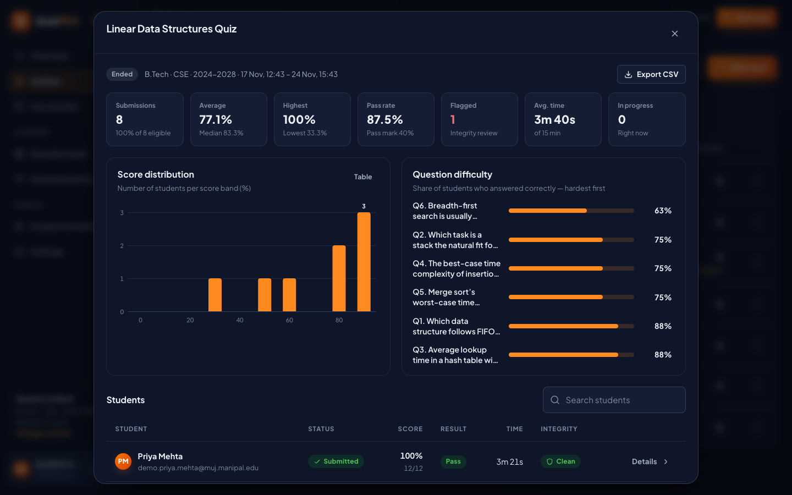<br><b>Results per quiz</b>: pass rate, score distribution, question difficulty and each student's integrity status.</td>
    <td width="50%">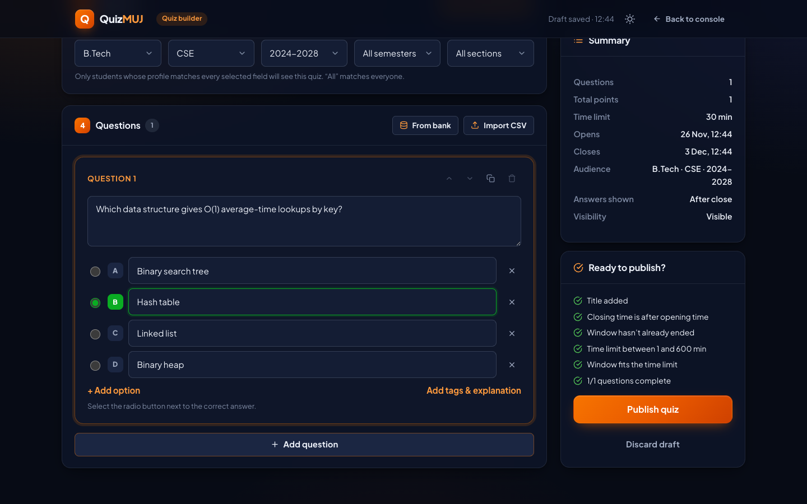<br><b>Quiz builder</b>: scheduling, cohort targeting, questions from the bank or a CSV, and a publish checklist.</td>
  </tr>
</table>

### Landing, sign-in and mobile

<table>
  <tr>
    <td width="50%"><br><b>Landing page</b></td>
    <td width="50%">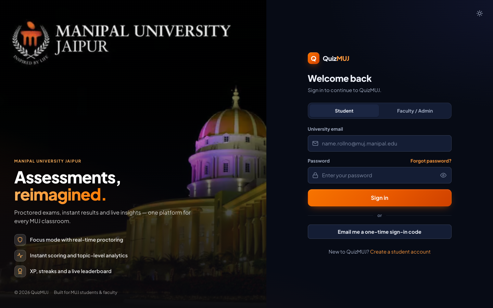<br><b>Sign-in</b> with a password or a one-time email code, for students and faculty.</td>
  </tr>
</table>

<p align="center">
  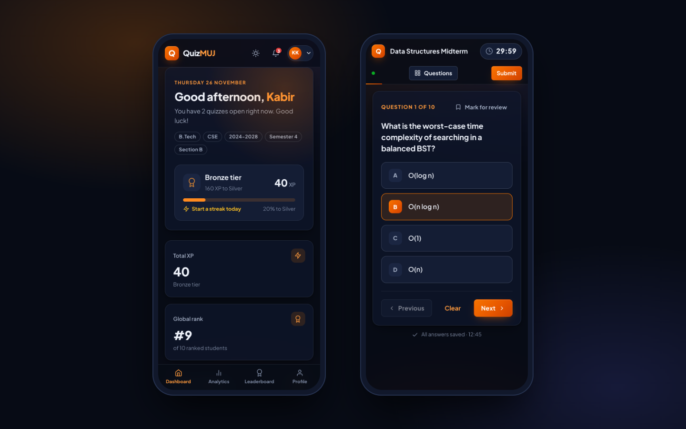
  <br><b>On phones</b>: the dashboard and the exam adapt to small screens.
</p>

---

## Features

### Students
- **Sign-up with a university email** (`@muj.manipal.edu`), verified by a 6-digit one-time code. Codes are rate-limited, expire after 10 minutes and burn after 5 wrong attempts. You can resend a code, sign in with a code instead of a password, or reset a forgotten password.
- **Academic profile** (program → branch → batch → semester → section). Students set it once at first sign-in, and it decides which quizzes they can take. It is then **locked** so nobody can hop into another section's exam: only faculty can correct it. Students can still change their name and password from *My profile*.
- **Dashboard**:
  - XP, global rank, tier progress, average score and day streak.
  - Live, upcoming, in-progress and completed quizzes with ticking countdowns.
  - Recent results.
  - A notification centre for announcements.
  - New quizzes appear in real time.
- **Focus-mode exams**:
  - A pre-exam lobby with the rules, then full screen.
  - The timer is controlled by the server. The deadline is the earlier of start time + time limit and the quiz closing time, so it can't be paused or extended.
  - Question palette, mark-for-review, keyboard shortcuts (`A`–`F`, `←/→`, `R`) and a review screen before submitting.
  - **Autosave** to the server and to the device. A reload, crash or device switch resumes where the student left off. A dropped connection retries the submission automatically.
- **Proctoring**: tab switches, leaving the window, exiting full screen, copy attempts and disconnects are recorded on the attempt and streamed to faculty live. More than 3 violations, or suspiciously fast answering, flags the attempt.
- **Results** with a pass/fail verdict, XP earned, an answer breakdown and a question-by-question review with explanations. To stop answer sharing, correct answers stay hidden until the quiz closes. This is configurable per quiz: *after close*, *immediately* or *never*.
- **Analytics**: score trend, topic mastery from question tags, "where you lost marks", and a searchable attempt history.
- **Leaderboard** with University / My batch / My section scopes, a podium, tiers (Bronze → Legend) and live updates.
- **External forms** (Google Forms / Microsoft Forms) embedded in the app, with per-student completion tracking.

### Faculty / admins
- **Overview**: students, live quizzes, submissions, average score, who's online, a 14-day activity chart, the live exam room and the latest submissions.
- **Quiz builder**:
  - Schedule window, time limit, points, pass mark, shuffled questions/options, answer-reveal policy and visibility.
  - Cohort targeting, and questions with a radio-selected correct answer, tags and explanations.
  - Import questions from the **question bank** or a **CSV**. Drafts autosave, and quizzes can be edited or duplicated.
  - Questions lock automatically once students have attempted a quiz, so results stay consistent.
- **Results & analytics per quiz**:
  - Participation rate, average, median, high/low, pass rate, flagged attempts and time on task.
  - Score distribution and question difficulty, including the most common wrong answer.
  - Per-student attempt forensics: a proctoring timeline plus every answer.
  - CSV export, protected against spreadsheet formula injection. Attempts can be reset to allow a retake.
- **Live monitor**: every student currently in an exam, with progress, time left, presence (active / away / disconnected) and violations, plus a real-time security feed. Each running quiz has a **force-end** button.
- **Question bank** with search, tags, CSV import (template included, rows that fail are skipped with reasons) and adding questions manually.
- **Students & admins**: search, verify stuck sign-ups, **correct a student's academic profile**, **move a whole batch to a new semester** at the start of term, suspend/restore (takes effect immediately) and delete accounts. You can also add more administrators.
- **Announcements** targeted to any cohort, pushed live and kept in each student's inbox.
- **Quick-start wizard** that sets a session "teaching context" used to pre-fill new quizzes, forms and announcements.

### Security
- Students can't make themselves admins: the registration role is fixed server-side.
- Correct answers are never sent to students before the reveal policy allows it.
- NoSQL-injection-safe inputs; hashed OTPs and passwords.
- Sessions are revoked after a password change. Banned users are rejected on every request and disconnected from sockets.
- Socket.io connections are authenticated with the same JWT as the REST API.
- All user content is HTML-escaped when rendered, which prevents stored XSS.
- Rate limits on authentication endpoints; security headers.

---

## Quick start (local)

Requirements: **Node.js ≥ 20.19** and **MongoDB** (local or Atlas).

```bash
cd backend
cp .env.example .env        # then edit MONGO_URI / JWT_SECRET / SMTP settings
npm install
npm start                   # or: npm run dev  (auto-reload)
```

Open **http://localhost:5001**. The API also serves the frontend, so there's nothing else to run.

- An admin account is created automatically on first start: `admin@quizmuj.com` / `admin123`. Override it with `ADMIN_EMAIL`, `ADMIN_PASSWORD` and `ADMIN_NAME`, and **change the password** under *Console → Settings*.
- Want something to click through? `npm run seed:demo` adds sample students, quizzes, attempts, a question bank and announcements without sending any email. Demo students sign in with `demo.akshat.sharma@muj.manipal.edu` / `Demo1234`, and every `demo.*` account uses the same password. To recreate the data, run `npm run seed:demo -- --reset`.
- If no SMTP credentials are set in development, sign-in and verification codes are **printed in the server console**. To check real email delivery, run `npm run test:email -- you@example.com`.
- Using VS Code Live Server (ports 5500–5502) for the frontend also works. The frontend then talks to the API on `:5001` automatically.

## Deploy to production

**Free showcase:** Render free plan + MongoDB Atlas M0, with `SHOWCASE_MODE` for one-click demo logins. It takes about 20 minutes; see the first section of the guide.

See **[DEPLOYMENT.md](DEPLOYMENT.md)**. It covers MongoDB Atlas plus a one-click Render Blueprint (`render.yaml`), Railway/Fly.io (root `Dockerfile`), or your own server with Docker Compose and HTTPS.

## Run with Docker

```bash
cp backend/.env.example backend/.env   # set JWT_SECRET, SMTP, admin credentials
docker compose up --build
```

| Service | URL |
|---|---|
| App (nginx, proxies `/api` + `/socket.io`) | http://localhost:8080 |
| API directly (this machine only) | http://localhost:5001/api/health |
| MongoDB (this machine only, no auth) | `mongodb://localhost:27017/quizmuj` |

## Configuration

All settings live in `backend/.env`. `backend/.env.example` documents every variable.

| Variable | Purpose |
|---|---|
| `MONGO_URI` | MongoDB connection string |
| `JWT_SECRET`, `JWT_EXPIRE` | Token signing secret and lifetime (e.g. `7d`) |
| `STUDENT_EMAIL_DOMAIN` | Domain students must register with (default `muj.manipal.edu`) |
| `ADMIN_EMAIL`, `ADMIN_PASSWORD`, `ADMIN_NAME` | First admin, created when no admin exists |
| `BREVO_API_KEY`, `FROM_EMAIL`, `FROM_NAME` | Email over Brevo's HTTPS API (for hosts that block SMTP, like Render's free plan) |
| `SMTP_HOST`, `SMTP_PORT`, `SMTP_EMAIL`, `SMTP_PASSWORD`, `FROM_EMAIL`, `FROM_NAME` | Outgoing email over SMTP, used when `BREVO_API_KEY` isn't set |
| `SHOWCASE_MODE` | Public demo: one-click demo logins, demo data rebuilt on every boot and every 6 hours. Use a separate database. |
| `TRUST_PROXY` | Proxy hops in front of the app (`1` on Render, Railway and Fly.io), needed for per-student rate limits |
| `CORS_ORIGIN` | Optional comma-separated list of allowed origins |
| `APP_TIMEZONE` | Timezone for the activity chart (default `Asia/Kolkata`) |

## CSV question format

```csv
QuestionText,Option1,Option2,Option3,Option4,CorrectAnswer,Explanation,Tags
"What is the time complexity of binary search?",O(n),O(log n),O(1),O(n log n),B,"The search space halves each step.","algorithms, searching"
```

- Up to 6 options are allowed (`Option1`–`Option6`).
- `CorrectAnswer` can be the option text, a letter (`A`–`F`) or a number (`1`–`6`).
- Column names are matched case-insensitively.
- A template is downloadable from *Question bank → Import CSV*.

## Project structure

```
backend/
  src/
    server.js            Express app, static frontend, boot
    realtime.js          Authenticated Socket.io: live exam room, proctoring, broadcasts
    config/              db connection, academic catalogue (programs/branches/batches)
    controllers/         auth, quizzes (attempt lifecycle), student, admin
    services/            attempt finalisation & auto-submit sweeper, leaderboard
    models/              User, Quiz, Result (attempts), QuestionBank, Announcement
    middlewares/         auth guard, error handler, showcase guards
    utils/               OTP, email, rate limiting, quiz helpers, demo data
  seed-admin.js          npm run seed [-- --reset]
  seed-demo.js           npm run seed:demo [-- --reset]
frontend/
  assets/css/app.css     design system (dark/light themes)
  assets/js/app.js       API client, auth guards, safe templating, toasts, modals, sockets
  assets/js/charts.js    dependency-free SVG charts
  assets/js/shell.js     student navigation & notification centre
  index.html             landing page
  login / register       authentication flows
  profile-setup          academic profile (first-run setup & editing)
  student-*              dashboard, exam, result, analytics, leaderboard
  external-quiz.html     Google/MS Forms wrapper
  admin.html (+ admin*.js)  faculty console
  create-quiz.html       quiz builder
  admin-wizard.html      quick-start session context
docs/screenshots/        README images
Dockerfile               single-container image (API + website)
render.yaml              Render Blueprint (free showcase by default)
docker-compose.yml       MongoDB + API + nginx
```

## API overview

All routes are prefixed with `/api/v1`. Protected routes take `Authorization: Bearer <token>`.

| Area | Endpoints |
|---|---|
| Auth | `POST /auth/register`, `/verify-otp`, `/resend-otp`, `/login`, `/request-login-otp`, `/verify-login-otp`, `/forgot-password`, `/reset-password` · `GET/PUT /auth/me` · `PUT /auth/update-password` |
| Quizzes | `GET/POST /quizzes` · `GET/PUT/DELETE /quizzes/:id` · `POST /quizzes/:id/start` · `PUT /quizzes/:id/progress` · `POST /quizzes/:id/submit` · `POST /quizzes/:id/complete-external` · `GET /quizzes/:id/result` |
| Student | `GET /student/my-quizzes`, `/overview`, `/results`, `/analytics`, `/leaderboard?scope=global\|batch\|section`, `/announcements` · `POST /student/announcements/seen` · `PUT /student/profile` |
| Admin | `GET /admin/stats`, `/live` · `GET /admin/quizzes/:id/results` · `POST /admin/quizzes/:id/force-end` · `POST /admin/quizzes/external` · `GET /admin/results/:quizId/csv` · `GET/DELETE /admin/results/:id` · `GET/POST /admin/questions` · `POST /admin/questions/bulk` · `DELETE /admin/questions/:id` · `GET /admin/users` · `PATCH/DELETE /admin/users/:id` · `POST /admin/users/promote` · `POST /admin/admins` · `GET/POST /admin/announcements` · `DELETE /admin/announcements/:id` |
| Meta | `GET /meta/academics`, `GET /meta/config`, `GET /api/health` |

## License

MIT
